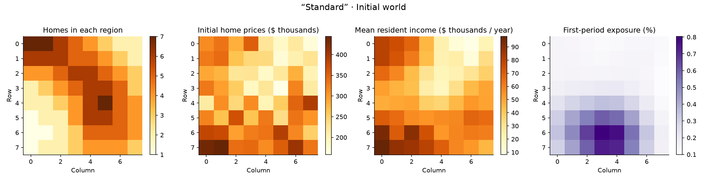
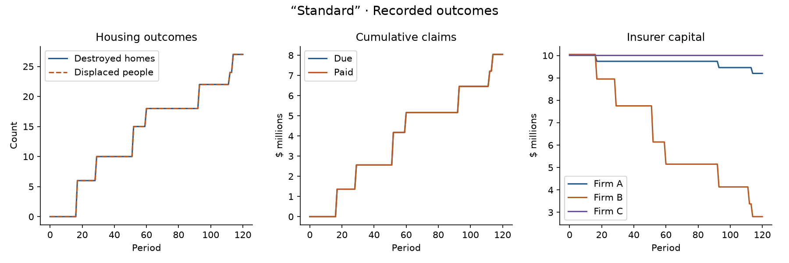

# insurance-land

A toy multi-agent housing and insurance market with seeded populations, spatial disaster exposure, and insurance claims. Run experiments to explore how initial inequality and disaster frequency affect housing and insurer capital.

## Run the command center

From the repository root, with [uv](https://docs.astral.sh/uv/) installed:

```bash
uv sync --locked
uv run python -m experiments.command_center
```

Open [http://127.0.0.1:8000](http://127.0.0.1:8000). The command center runs named experiments, saves their results, and provides maps, charts, and recorded event histories. Keep the server running while experiments execute.

The included reference experiments are **Dev Peace**, **Dev Standard**, and **Dev Chaos**. Peace starts with equal allocations; Standard introduces unequal income, ownership, and prices with a low constant disaster rate; Chaos uses Standard's initial population with an exponentially increasing disaster rate. Experiment names are separate from their Peace, Standard, or Chaos type.

See [getting started](docs/getting-started.md) for server options, saved results, and regenerating the reference experiments.

## Example snapshots

These figures come from the recorded Standard experiment with seed 42 and 120 periods. They illustrate one seeded run using fixed baseline policies, not trained agents or calibrated predictions.

### Initial conditions

Neighborhoods differ in population, home prices, resident income, and disaster exposure. Exposure is the probability of at least one hit in the first period.



### Recorded outcomes

Disasters destroy homes, displace residents, and trigger insurance payments that reduce insurer capital. The housing curves overlap because this run has no relocation or rebuilding. Claims due and paid also overlap in this example.



## Terminal example

For a small three-period simulation that prints its results:

```bash
uv run python main.py
```

See [the documentation](docs/README.md) for the model and project structure, and [initial-distribution setup](docs/initial-distributions.md) for configuration and insurance rules.
