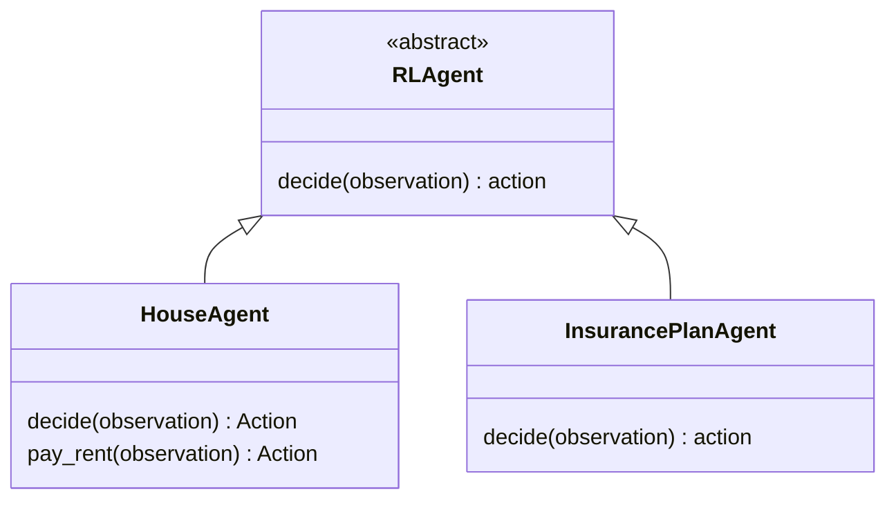

# Agents and decision policies

The controller classes are exported by [src/agents/__init__.py](../src/agents/__init__.py): `RLAgent`, `HouseAgent`, and `InsurancePlanAgent`.

## Inheritance and responsibility



`RLAgent[ObservationT, ActionT]` defines an abstract `decide` method. Its generic parameters describe the observation a controller consumes and the action it produces. The interface is the connection point for a decision policy, including a policy supplied by a learning algorithm.

`HouseAgent` specializes it for the housing observation and action types. `InsurancePlanAgent` takes a policy callable and retains generic observation and action types so its policy contract can be selected by the caller.

Economic state belongs to domain records. Agent objects hold decision behavior and any policy state. The environment's controller mapping associates one `HouseAgent` instance with each person ID.

## House observations

`Observation` is a frozen dataclass in [base.py](../src/agents/base.py):

| Field | Type | Meaning |
| --- | --- | --- |
| `period` | `int` | Period associated with this observation |
| `person` | `Entity` | The controlled person's budget and income |
| `household` | `Household` | The person's single-person household |
| `residence` | `Home \| None` | The home occupied by this person |
| `region` | `Region \| None` | Region of the residence |
| `owned_homes` | `tuple[Home, ...]` | All homes owned by the person |

Calling `environment.observe(person_id)` returns the committed state at the current period. During automatic stepping, the environment supplies agents with observations for the upcoming period after crediting income and before settling any actions.

## House actions

`Action` is the union `Wait | PayRent`.

| Action | Meaning |
| --- | --- |
| `Wait()` | Take no housing action this period |
| `PayRent(home_id)` | Request one rent payment for the specified residence |

A returned action is a request. The environment checks its type and ownership of the decision: the requesting person must occupy the referenced home. The market then checks available funds and transfers cash.

`Wait` still allows the ordinary period progression and income credit. Its action result has `paid=None`.

## Rent is a house-agent behavior

`HouseAgent.pay_rent(observation)` selects a rent-related action:

- A person without a residence receives `Wait()`.
- A person who owns their residence receives `Wait()`.
- A resident with zero rent receives `Wait()`.
- A tenant with positive rent receives `PayRent(residence.id)`.

The method requests a payment even if the observed cash is insufficient; affordability is settled by the market. This keeps the decision and its economic outcome explicit.

The default `HouseAgent.decide` calls `pay_rent`. Supplying a policy callable makes `decide` delegate to that callable instead. The rent behavior remains available as a method when writing a custom policy or subclass.

## Injecting a policy

This policy deliberately waits, demonstrating how to replace the default decision behavior:

```python
from src.agents import HouseAgent
from src.agents.base import Action, Observation, Wait
from src.factories import EnvironmentFactory, PopulationConfig, RegionConfig


def wait_policy(observation: Observation) -> Action:
    return Wait()


environment = EnvironmentFactory.create(
    PopulationConfig(regions=(RegionConfig(name="Coast", households=2),)),
    agent_factory=lambda person: HouseAgent(policy=wait_policy),
)
result = environment.step()
assert all(isinstance(outcome.action, Wait) for outcome in result.actions)
```

A policy can use `observation.person.cash`, the residence's rent, owned assets, or region information to decide. It returns an action for the environment to process.

## Specializing a house agent

A subclass is appropriate when the controller has state or several related behaviors. This example records the cash it observes while retaining the standard rent decision:

```python
from decimal import Decimal

from src.agents import HouseAgent
from src.agents.base import Action, Observation
from src.factories import EnvironmentFactory, PopulationConfig, RegionConfig


class RecordingHouseAgent(HouseAgent):
    def __init__(self) -> None:
        super().__init__()
        self.observed_cash: list[Decimal] = []

    def decide(self, observation: Observation) -> Action:
        self.observed_cash.append(observation.person.cash)
        return self.pay_rent(observation)


environment = EnvironmentFactory.create(
    PopulationConfig(regions=(RegionConfig(name="Coast", households=2),)),
    agent_factory=lambda person: RecordingHouseAgent(),
)
environment.step()
```

Construct a separate instance for every person. The environment verifies instance identity as well as the set of person IDs in the controller mapping.

## Insurance policy interface

[InsurancePlanAgent](../src/agents/insurance.py) wraps a required policy callable. The caller chooses the input and output types. Its `decide` method passes the observation to that callable and returns the result.

The following standalone example uses a decimal expected cost as its input and a decimal quote as its output. The multiplier is illustrative policy logic supplied by the example:

```python
from decimal import Decimal

from src.agents import InsurancePlanAgent


def quote_policy(expected_cost: Decimal) -> Decimal:
    return expected_cost * Decimal("1.10")


agent = InsurancePlanAgent[Decimal, Decimal](policy=quote_policy)
assert agent.decide(Decimal("100")) == Decimal("110.00")
```

This interface is used directly by its caller. `Environment.step` coordinates the housing action contract, `Wait | PayRent`, through its house-agent mapping.
