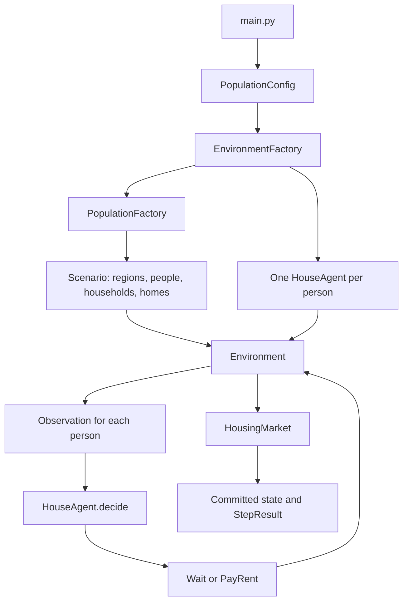

# Architecture

## Project layout

```text
insurance-land/
├── main.py                # Experiment runner
├── environment.py         # Simulation orchestration
├── agents/                # Policy interfaces and baselines
├── domain/                # Housing, insurance, disasters, and records
├── factories/             # Population and environment construction
├── utils/
│   ├── distributions.py   # Reusable mathematical generators
│   └── validation/
├── tests/
├── docs/
├── plans/
├── pyproject.toml
└── uv.lock
```

`main.py` runs experiments. Root-level packages group code by responsibility, with imports such as `from factories import EnvironmentFactory`.

## Responsibilities

| Module | Responsibility |
| --- | --- |
| [main.py](../main.py) | Choose an experiment configuration, construct the environment, run periods, and report results |
| [environment.py](../environment.py) | Assemble related objects, expose observations, collect decisions, validate actions, and commit each period |
| [domain/models.py](../domain/models.py) | Define economic records and validate their local values |
| [domain/housing.py](../domain/housing.py) | Maintain people and homes, enforce housing relationships, and apply economic changes |
| [agents/base.py](../agents/base.py) | Define the generic controller interface and the house observation/action types |
| [agents/house.py](../agents/house.py) | Implement house decisions, including the rent-payment behavior |
| [agents/insurance.py](../agents/insurance.py) | Adapt an insurance policy callable to the shared controller interface |
| [factories/population.py](../factories/population.py) | Generate an initial scenario from population parameters and a seed |
| [factories/environment.py](../factories/environment.py) | Attach a separate house agent to each person and construct the environment |
| [utils/validation](../utils/validation/) | Share money validation and unique-ID indexing helpers |

## Construction and execution flow



The population factory describes an initial world. The environment factory supplies its controllers. The environment then coordinates the repeated decision-and-settlement cycle.

## Economic state and controllers

An `Entity` is a person's economic record. A `HouseAgent` is that person's controller. The controller receives an observation and returns an action; cash and home records live in the market.

Each agent is keyed by the ID of the person it controls. A household has its own ID and a `person_id` reference. Factory-generated household IDs happen to equal person IDs, but explicitly constructed scenarios can use different household IDs.

A home carries `owner_id` and `occupant_id`. Ownership queries and residence queries derive their answers from those records, keeping one authoritative representation of each relationship.

## State protection

Economic models are frozen dataclasses with slots. Updates create replacement records through `dataclasses.replace`. Public collections are exposed as read-only mappings, so callers can inspect balances and homes without replacing entries through the public API.

At the beginning of a step, the environment copies the market's dictionaries. Frozen records can be shared safely between the original and working copy until an update replaces them. After successful processing, the working market becomes the committed market.

An observation holds immutable records from the moment it was created. Keeping an observation from a prior period preserves that view even after later steps update balances. Obtain current records through the environment again after advancing a period.

Agents themselves can carry mutable policy state. Their lifecycle is separate from the immutable economic records; see [simulation lifecycle](simulation.md) for how this interacts with errors.

## Where validation belongs

Value-level validation belongs with records: money must be finite and nonnegative, for example. Relationship validation belongs with the component that can see the related objects. `HousingMarket` verifies owners and residents, while `Environment` verifies regions, household membership, and agent assignments.

The environment also checks action authority. A person can request payment only for their own residence, even if a custom policy returns another home's ID.
