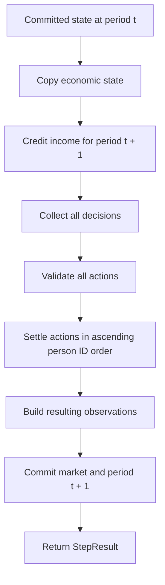

# Environment and simulation lifecycle

[Environment](../src/environment.py) connects the economic records to controllers and coordinates each simulation period. [src/main.py](../src/main.py) decides how many times to advance it.

## Assembly

Construction accepts a `Scenario` and a mapping from person IDs to `HouseAgent` instances. The environment checks these relationships:

1. Region, person, household, and home IDs are unique within their respective collections.
2. Each household references an existing person.
3. Each person belongs to exactly one household.
4. Agent IDs match person IDs exactly, with a distinct controller instance for each person.
5. Each home references an existing region and owner.
6. Every resident exists and occupies at most one home.

IDs are scoped to their record type: region 1, person 1, household 1, and home 1 can coexist. Household membership uses `person_id`, even when the household's own ID differs.

The constructed environment starts at `period == 0`. Domain records and the environment's collections can then be inspected through its public properties.

## Public API

| Member | Purpose |
| --- | --- |
| `period` | Current committed period |
| `people` | Read-only mapping of person IDs to `Entity` records |
| `homes` | Read-only mapping of home IDs to `Home` records |
| `households` | Read-only mapping of household IDs to `Household` records |
| `regions` | Read-only mapping of region IDs to `Region` records |
| `agents` | Read-only mapping of person IDs to their house-agent instances |
| `observe(person_id)` | Build a current observation for one person |
| `homes_in_region(region_id)` | Return homes located in a region |
| `households_in_region(region_id)` | Return households residing in a region |
| `step(actions=None)` | Advance one period using controllers or supplied actions |

## One period, in order



### 1. Prepare a working market

The environment copies its market's dictionaries. Because the records are immutable, existing records can be shared until replaced. Processing then takes place against this working market.

If the caller supplied actions, their keys must already cover every person exactly once. Missing or extra keys are rejected before income is credited.

### 2. Credit income

Each person's new working balance is:

```text
cash after income = cash before step + income
```

Income is credited once per successful period, including for people whose action is `Wait`. The period is a simulation unit; keep all income and rent amounts consistent with the chosen unit.

### 3. Collect decisions

With `step()`, the environment calls every house agent's `decide` method in ascending person ID order. All agents observe the state after income credit and before any action is settled. Each observation carries period `t + 1`.

With `step(actions=...)`, the environment uses the supplied action mapping and bypasses calls to the controllers.

### 4. Validate the complete action set

Each action must be `Wait` or `PayRent`. A rent action must identify an existing home occupied by the requesting person. Validation finishes for the full set before any rent is transferred.

### 5. Settle actions

Actions settle in ascending person ID order. `Wait` does nothing to cash. `PayRent` calls the market's settlement function and records its boolean outcome.

Decisions are made from the same phase of state, while settlement uses the progressively updated balances. For example, rent received by a lower-ID landlord during settlement can fund that landlord's later payment only if their own payment occurs after the receipt. Reproducible IDs therefore also establish reproducible settlement ordering.

### 6. Commit and return

The environment builds observations from the resulting market, replaces the committed market, advances the period counter, and returns a `StepResult`.

## Results

`StepResult` contains:

| Field | Meaning |
| --- | --- |
| `period` | The newly committed period |
| `actions` | Tuple of `ActionResult` objects in ascending person ID order |
| `observations` | Read-only mapping of person IDs to their resulting observations |

Each `ActionResult` contains `person_id`, the chosen `action`, and `paid`:

| `paid` | Meaning |
| --- | --- |
| `True` | The rent action succeeded under the domain's payment rules |
| `False` | The rent action could not be funded |
| `None` | The chosen action was `Wait` |

A successful zero-rent or owner-occupied rent action transfers zero cash. The default house policy chooses `Wait` for these cases, while a caller supplying explicit actions may request them directly.

Old observations and returned results retain the immutable records they captured. Reading `environment.people` after a step obtains the current balances.

## Worked cash flow

Suppose person 10 owns the home occupied by person 20:

| Person | Starting cash | Income | Rent obligation |
| --- | ---: | ---: | ---: |
| 10 | 1,000 | 10 | 0 |
| 20 | 50 | 60 | 100 paid to person 10 |

After income credit, their balances are 1,010 and 110. The tenant requests payment, so the committed balances become 1,110 and 10.

In the next period, the tenant has 70 after income. The 100 payment returns `False`; their balance remains 70 and their residence remains the same. The period still commits because insufficient funds is an economic outcome, rather than an invalid action.

## Explicit action control

This complete example advances a generated world with every person choosing to wait:

```python
from src.agents.base import Wait
from src.factories import EnvironmentFactory, PopulationConfig, RegionConfig

environment = EnvironmentFactory.create(
    PopulationConfig(regions=(RegionConfig(name="Coast", households=3),))
)
actions = {person_id: Wait() for person_id in environment.people}
result = environment.step(actions)

assert result.period == 1
assert all(outcome.paid is None for outcome in result.actions)
```

Complete action mappings are useful when a caller collects decisions externally or needs precise control over a test scenario.

## Error handling and transaction boundary

Invalid references and action mappings raise `ValueError`; unsupported action types raise `TypeError`. Exceptions raised by a controller propagate to the caller. Failures before commit preserve the previous economic state and period.

Agent-internal state is managed by the agent. If a controller records an observation or advances its random generator before another controller fails, that controller state has already changed. Callers retrying a failed step should account for this when designing stateful policies.

Insufficient cash follows a separate path: the payment returns `False`, other valid actions continue, and the period commits normally.

## Main loop

The entry point constructs one environment, then calls `step()` in a loop. Population setup belongs before the loop; per-period reporting belongs after each returned result. To start an independent run, construct another environment through the factory, using the desired configuration and fresh controllers.
